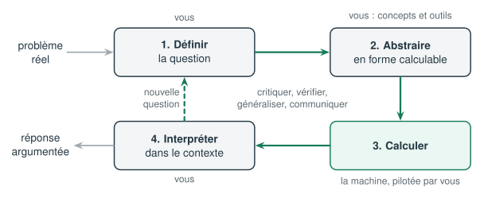

# Le processus en 4 étapes

Résoudre un problème avec des mathématiques, ce n'est pas d'abord calculer. Le référentiel *Computer-Based Maths* décrit un cycle en 4 étapes, que l'on parcourt souvent plusieurs fois :

| Étape | Ce qu'on fait | Qui le fait |
|---|---|---|
| **1. Définir la question** | trier l'information, repérer ce qui manque, formuler une question précise, écrire ses hypothèses | vous |
| **2. Abstraire** | traduire la question en objets mathématiques (vecteurs, matrices, systèmes), choisir un concept puis un outil | vous |
| **3. Calculer** | exécuter le calcul, combiner des outils, déboguer | Python, piloté par vous |
| **4. Interpréter** | revenir au problème réel, lire le résultat, en tirer des conclusions et de nouvelles questions | vous |

Autour de ces étapes, cinq compétences transversales sont travaillées en continu : la **confiance** face à un problème nouveau, le **flair** (sentir quand un résultat « sent mauvais »), la **critique et la vérification**, la **généralisation** et la **communication**.

## Concept ou outil ?

Le référentiel distingue soigneusement :

- le **concept** : ce que l'on veut faire. Par exemple, « mesurer la ressemblance entre deux profils » ou « résoudre un système » ;
- l'**outil** : ce que l'on utilise pour le faire. Par exemple, la distance euclidienne, la similarité cosinus, `numpy.linalg.solve` ou le pivot de Gauss à la main.

Pour un même concept, il existe souvent plusieurs outils. Savoir les comparer fait partie des compétences évaluées (codes Tc et Tr).

## Le gabarit des notebooks

Tous les notebooks suivent la même structure, pour que le processus lui-même devienne familier :

1. **En-tête** : module, durée, codes évalués, prérequis.
2. **① Définir la question** : une situation volontairement floue ; vous listez les informations utiles, celles qui manquent, vos hypothèses.
3. **② Estimer avant de calculer** : vous enregistrez un pari chiffré. Le notebook le compare au résultat final.
4. **③ Abstraire** : schéma, choix du concept et de l'outil parmi plusieurs options, calcul à la main sur une version réduite.
5. **④ Calculer** : le code Python, en cellules courtes. Certaines contiennent une erreur volontaire à trouver.
6. **⑤ Interpréter** : lecture du résultat dans le contexte, traits remarquables, hypothèses nouvelles.
7. **⑥ Critiquer et généraliser** : quelle hypothèse est la plus fragile ? comment vérifier autrement ? quelle constante pourrait devenir un paramètre ?
8. **Bilan** : auto-évaluation sur les codes visés.

Les cellules marquées **À vous** attendent votre réponse. Ne les sautez pas : c'est là que se joue l'essentiel de l'apprentissage.
