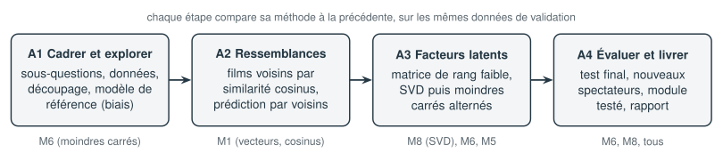

# Projet A — Recommandation de films

**Question ouverte : quels films proposer à un spectateur qu'on connaît peu ?**

La médiathèque de la ville lance un service de films en ligne. Elle veut proposer à chaque abonné une sélection personnalisée, y compris aux nouveaux abonnés qui n'ont noté que quelques films. Vous disposez d'un tableau de notes : qui a noté quel film, et combien d'étoiles.

| Données | Modules réinvestis | Durée |
|---|---|---|
| MovieLens, version réduite (environ 100 000 notes de 600 spectateurs), ou un jeu simulé de même format | M1, M5, M6, M8 | 13 à 15 h |

## Les étapes

| Étape | Contenu | Durée |
|---|---|---|
| [A1 Cadrer et explorer](A-recommandation-films/A1-cadrer-et-explorer.ipynb) | Découper la question, explorer les notes (longue traîne, matrice presque vide), découper les données en trois paquets, modèle de référence par moindres carrés régularisés | 3 h |
| [A2 Des films qui se ressemblent](A-recommandation-films/A2-ressemblances.ipynb) | Chaque film devient un vecteur ; similarité cosinus atténuée, voisins d'un film, prévision par les voisins, vérification par les genres | 3 h |
| [A3 Facteurs latents](A-recommandation-films/A3-facteurs-latents.ipynb) | Approximation de rang faible d'une matrice incomplète : SVD de la matrice complétée, puis moindres carrés alternés ; réglage de $k$ et $\lambda$ ; sens des facteurs | 3 h 30 |
| [A4 Évaluer, généraliser, communiquer](A-recommandation-films/A4-evaluer-et-livrer.ipynb) | Test final, erreurs aléatoires et systématiques, qualité du classement, nouveaux abonnés, module Python testé, rapport et présentation | 4 h |

Chaque étape suit le processus en quatre temps du parcours et se termine par un bilan. Les étapes A1 à A3 comparent leurs méthodes sur le même paquet de **validation** ; le paquet de **test** reste sous scellés jusqu'à l'étape A4.

## Les données

Le jeu **MovieLens** est publié par le laboratoire GroupLens de l'université du Minnesota pour la recherche et l'enseignement. Sa licence en interdit la redistribution : le module `films.py` du projet le télécharge sur votre ordinateur, depuis le site de GroupLens, à la première utilisation (environ 1 Mo). Sans connexion, il utilise un **jeu simulé** au même format, fourni dans `donnees/simule` : les conclusions sont du même ordre, mais les chiffres diffèrent.

Pour choisir explicitement la source : `charger_films("movielens")` ou `charger_films("simule")`.

## Fichiers du projet

| Fichier | Rôle |
|---|---|
| `films.py` | chargement des données, découpage, erreur, index de la matrice, modèle des biais |
| `donnees/simule/` | jeu de notes simulé (format MovieLens) |
| `corrige/recommandation.py` | module de référence : la classe `Recommandeur` |
| `corrige/test_recommandation.py` | ses tests (`python test_recommandation.py` ou `pytest`) |

## Livrables

- [ ] Les quatre notebooks, propres et exécutables de bout en bout
- [ ] Un module `recommandation.py` et son fichier de tests
- [ ] Un rapport de 4 à 6 pages (plan proposé dans l'étape A4)
- [ ] Une présentation de 10 minutes, 6 diapositives au plus
- [ ] Les bilans des quatre étapes, et une auto-évaluation sur les 11 dimensions

:::{important} Ce que le projet travaille surtout
Découper un problème trop gros pour être résolu d'un coup ; repérer l'information qui manque ; corroborer chaque résultat par une autre voie ; transformer un calcul en programme fiable ; structurer un rapport.
:::
