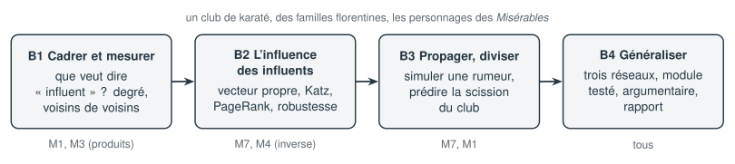

# Projet B — Influence dans un réseau social

**Question ouverte : qui sont les membres les plus influents d'un réseau, et selon quel critère ?**

« Influent » peut vouloir dire avoir beaucoup d'amis, avoir des amis importants, diffuser vite une information, ou tenir les passages entre des groupes qui ne se parlent pas. Ce projet construit ces différentes mesures avec l'algèbre linéaire, les met à l'épreuve sur un événement réel, la scission d'un club, puis en tire des conclusions générales sur trois réseaux.

| Données | Modules réinvestis | Durée |
|---|---|---|
| Le club de karaté de Zachary (34 membres), les mariages florentins de Padgett (15 familles), les personnages des *Misérables* (77 personnages) | M1, M4, M7 | 12 h 30 |

## Les étapes

| Étape | Contenu | Durée |
|---|---|---|
| [B1 Cadrer et mesurer](B-influence-reseau/B1-cadrer-et-mesurer.ipynb) | Les sens du mot « influent », la fiabilité d'une source ancienne, la matrice d'adjacence, le degré et les voisins de voisins par produits de matrices | 2 h 30 |
| [B2 L'influence des influents](B-influence-reseau/B2-influence-recursive.ipynb) | Centralité de vecteur propre, centralité de Katz (et sa condition $\alpha < 1/\lambda_1$), PageRank ; robustesse du classement au retrait d'un lien | 3 h |
| [B3 Propager une rumeur, prédire une scission](B-influence-reseau/B3-propager-et-diviser.ipynb) | Simulation d'une rumeur pour départager les mesures ; prévision de la scission du club par le vecteur de Fiedler du laplacien | 3 h |
| [B4 Généraliser et convaincre](B-influence-reseau/B4-generaliser-et-convaincre.ipynb) | Intermédiarité ; trois réseaux, six mesures ; conclusions générales ; argumentaire sur les Médicis ; module Python testé ; rapport et présentation | 4 h |

## Les données

Les trois réseaux sont des classiques de l'analyse des réseaux sociaux, publiés dans la littérature scientifique et diffusés librement ; les fichiers du projet ont été exportés depuis la bibliothèque `networkx`.

- **Club de karaté** : W. W. Zachary, « An information flow model for conflict and fission in small groups », *Journal of Anthropological Research*, 1977. Le poids d'un lien compte les contextes où deux membres se rencontraient.
- **Familles florentines** : J. Padgett et C. Ansell, « Robust action and the rise of the Medici, 1400-1434 », *American Journal of Sociology*, 1993. Un lien représente un mariage entre deux familles.
- **Les Misérables** : D. E. Knuth, *The Stanford GraphBase*, 1993. Deux personnages sont liés s'ils apparaissent dans un même chapitre ; le poids compte ces chapitres.

## Fichiers du projet

| Fichier | Rôle |
|---|---|
| `reseaux.py` | chargement des trois réseaux (matrice d'adjacence, pondérée ou non) et dessin |
| `donnees/` | les membres (avec des positions de dessin) et les liens de chaque réseau |
| `corrige/reseau.py` | module de référence : mesures d'influence, coupe spectrale, propagation |
| `corrige/test_reseau.py` | ses tests (`python test_reseau.py` ou `pytest`) |

## Livrables

- [ ] Les quatre notebooks, propres et exécutables de bout en bout
- [ ] Un module `reseau.py` et son fichier de tests
- [ ] Un rapport de 4 à 6 pages (plan proposé dans l'étape B4)
- [ ] Une présentation de 10 minutes, 6 diapositives au plus
- [ ] Les bilans des quatre étapes, et une auto-évaluation sur les 11 dimensions

:::{important} Ce que le projet travaille surtout
Juger si une approche par le calcul est plausible ; mesurer l'effet des hypothèses et des choix de mesure ; formuler des hypothèses qui dépassent les données ; distinguer les faits qui soutiennent un argument de ceux qui l'affaiblissent ; tirer des conclusions générales à partir de plusieurs cas.
:::
