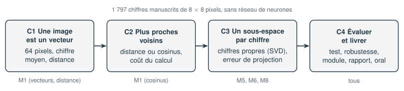

# Projet C — Reconnaître des chiffres manuscrits

**Question ouverte : peut-on reconnaître un chiffre écrit à la main sans réseau de neurones, avec les seuls outils de l'algèbre linéaire ? Jusqu'où, et à quel prix ?**

Une image de 8 × 8 pixels est un vecteur de $\mathbb{R}^{64}$. Ce projet construit trois façons de la reconnaître, du chiffre moyen le plus proche aux sous-espaces obtenus par décomposition en valeurs singulières, les compare sur leur réussite, leur coût et leur robustesse, puis s'interroge sur ce que vaut vraiment un taux de réussite mesuré.

| Données | Modules réinvestis | Durée |
|---|---|---|
| 1 797 chiffres manuscrits numérisés en 8 × 8 pixels (jeu UCI, version scikit-learn) | M1, M5, M6, M8 | 12 h |

## Les étapes

| Étape | Contenu | Durée |
|---|---|---|
| [C1 Une image est un vecteur](C-chiffres-manuscrits/C1-cadrer-et-explorer.ipynb) | Cadrer la question, représenter une image par un vecteur, reconnaître par le chiffre moyen le plus proche ; matrice de confusion et galerie des erreurs | 2 h 30 |
| [C2 Les plus proches voisins](C-chiffres-manuscrits/C2-plus-proches-voisins.ipynb) | Distance ou cosinus, choix du nombre de voisins sur un paquet de validation ; toutes les distances par un produit de matrices ; coût en temps et en mémoire | 2 h 30 |
| [C3 Un sous-espace par chiffre](C-chiffres-manuscrits/C3-sous-espaces.ipynb) | Chiffres propres par décomposition en valeurs singulières, reconnaissance par le plus petit résidu de projection, choix de la dimension ; décision avec rejet | 3 h |
| [C4 Évaluer, éprouver, communiquer](C-chiffres-manuscrits/C4-evaluer-et-livrer.ipynb) | Ouverture du paquet de test, erreur aléatoire et erreur systématique, robustesse au décalage et au bruit, votre propre chiffre ; module Python testé ; rapport, présentation et relecture croisée | 4 h |

## Les données

Les images proviennent du jeu « Optical Recognition of Handwritten Digits » d'E. Alpaydin et C. Kaynak (UCI Machine Learning Repository, 1998, licence CC BY 4.0), dans la version distribuée avec la bibliothèque `scikit-learn`. Les formulaires d'origine ont été numérisés, puis chaque chiffre a été centré et réduit à 8 × 8 pixels ; chaque pixel vaut de 0 (blanc) à 16 (noir). Ces chiffres ont été écrits par **une dizaine de personnes seulement** : l'étape C4 en tire les conséquences.

## Fichiers du projet

| Fichier | Rôle |
|---|---|
| `chiffres.py` | chargement des images, découpage stratifié, affichage en grille, matrice de confusion |
| `donnees/chiffres.csv` | une ligne par image : le chiffre écrit, puis les 64 pixels |
| `corrige/reconnaissance.py` | module de référence : la classe `Reconnaisseur` (chiffre moyen, voisins, sous-espaces, rejet) |
| `corrige/test_reconnaissance.py` | ses tests (`python test_reconnaissance.py` ou `pytest`) |

## Livrables

- [ ] Les quatre notebooks, propres et exécutables de bout en bout
- [ ] Un module `reconnaissance.py` et son fichier de tests
- [ ] Un rapport de 4 à 6 pages (plan proposé dans l'étape C4)
- [ ] Une présentation de 10 minutes, 6 diapositives au plus
- [ ] Les bilans des quatre étapes, et une auto-évaluation sur les 11 dimensions

:::{important} Ce que le projet travaille surtout
Réduire un problème réel à un problème déjà résolu (distances, projections, valeurs singulières) ; choisir un réglage sans tricher avec le paquet de test ; distinguer erreur aléatoire et erreur systématique ; comparer des méthodes sur plusieurs critères ; communiquer une promesse avec ses conditions.
:::
